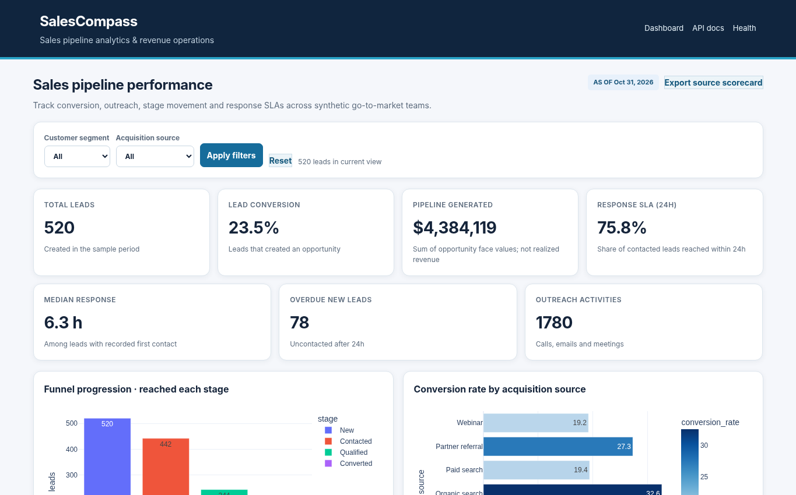

# SalesCompass — Sales Funnel & Revenue Operations Analytics

> **Sales analytics • Funnel conversion • Outreach effectiveness • SQL reporting**  
> An independent portfolio project by **Suhas Ramachandra**. Built to demonstrate early-career sales/revenue operations analytics capabilities.



**Business challenge.** Sales leaders need to know which lead sources generate opportunities, where funnel movement slows, and whether new leads receive timely follow-up.

## What this application does

- Filter the sales dashboard by customer segment and acquisition channel
- Measure lead-to-opportunity conversion, median first response time, 24-hour contacted-lead SLA and overdue new leads
- Visualize cumulative funnel stage reach, source conversion, stage transition durations and outreach-touch correlations
- Generate an evidence-based manager action queue with concrete next-step recommendations
- Export leads, activities, opportunities and acquisition scorecards to CSV
- Create a SQLite reporting database with indexed tables, reusable views and a SQL-report API

## Quick start

**Requirements:** Python 3.10+ and pip. Works locally on Windows, macOS and Linux. No database server and no external account are required for the core demo.

```bash
# In this repository folder
python -m venv .venv
# macOS/Linux:
source .venv/bin/activate
# Windows PowerShell:
# .venv\Scripts\Activate.ps1
pip install -r requirements.txt
python run.py
```

Open **http://127.0.0.1:8011** in your browser. To stop the server, press Ctrl+C.

### Run the tests

```bash
python -m pytest -q
```

### Regenerate the demo data

```bash
python data/generate_data.py
```

### Materialize and query the SQL reporting model

```bash
python data/build_sqlite.py
# open runtime/salescompass.sqlite3 with your preferred SQLite browser
# execute statements in sql/analysis.sql
```

The dashboard's **`/api/sql-report`** endpoint rebuilds the SQL model and queries the source funnel view.

## Walkthrough for reviewers

1. Click the Enterprise segment filter; compare conversion and pipeline with the unfiltered view.
2. Read the source scorecard and discuss why source conversion should not be confused with causal marketing effectiveness.
3. Inspect response SLA breaches and export the complete lead list. Visit `/api/sql-report` to verify SQL-backed source metrics.

## Design and data

- **Data:** 520 leads, 1,780 outreach activities, 122 opportunities, stage change histories. Values generated with a fixed random seed.
- **Stack:** FastAPI, Python, Pandas, Plotly (bundled for offline browser rendering), SQLite, SQL, pytest, HTML/CSS
- **Architecture:** [docs/architecture.md](docs/architecture.md)
- **Definitions and caveats:** [docs/metric_definitions.md](docs/metric_definitions.md)
- **Interview-ready case study:** [docs/project_story.md](docs/project_story.md)
- **API reference:** http://127.0.0.1:8011/docs (while server is running)

## Repository layout

```text
src/                Business logic + HTTP routes
data/               Deterministic synthetic data generator and raw CSV files
templates/          Interactive dashboard pages
static/             CSS + bundled Plotly JavaScript (no CDN required)
tests/              Automated behavior and regression checks
docs/               Architecture, data definitions, interview notes, screenshot
runtime/            Local state/output, intentionally excluded from Git
run.py              Starts the local web application
requirements.txt    Python dependencies
```

## Limits and interpretation

Synthetic SaaS-like data, no real HubSpot/Outreach access; no propensity adjustments or causal inference; incomplete stage durations are excluded (right-censored); opportunities represent face-value pipeline, not recognized revenue.

This project is a **simulated portfolio implementation** and does not represent an employer deployment, business cost saving or private client data. The code is intended as a reproducible showcase. The app binds to `127.0.0.1` for local development and has no authentication; **do not deploy publicly without authentication and security hardening**.

## Project credit

**Created for Suhas Ramachandra's analytics portfolio.** MIT License. These synthetic scenarios and repository assets are original artifacts created for this portfolio; technical methods are common industry practices.
