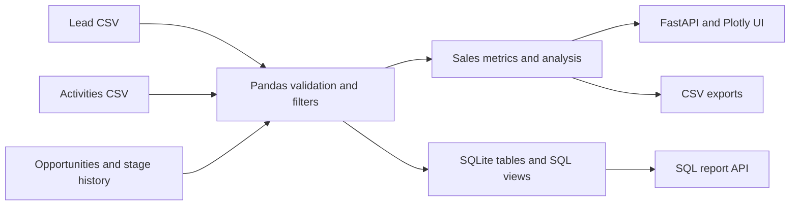

# Architecture and business rules

### Primary data entities

`leads` stores lead identity, source, segment, owner, timestamps and lifecycle status. `activities` captures calls, emails and meetings. `stage_history` tracks when leads first reached each stage. `opportunities` contains opportunity value, stage and ownership after conversion.

**Source-of-truth rules:** lead IDs are unique; opportunities link to existing leads; all timestamps are measured against the fixed 2026-10-31 scenario clock. The SQL materialization creates indexed reporting tables and two reusable views. The core dashboard operates on reproducible Pandas transformations; the separate SQL view is exposed for technical inspection.

### Reproducibility

All data are fabricated using a fixed pseudo-random seed. The fixed sample-clock avoids misleading changes in SLA figures when a reviewer opens the project later. No personally identifying records from a real company are included.
